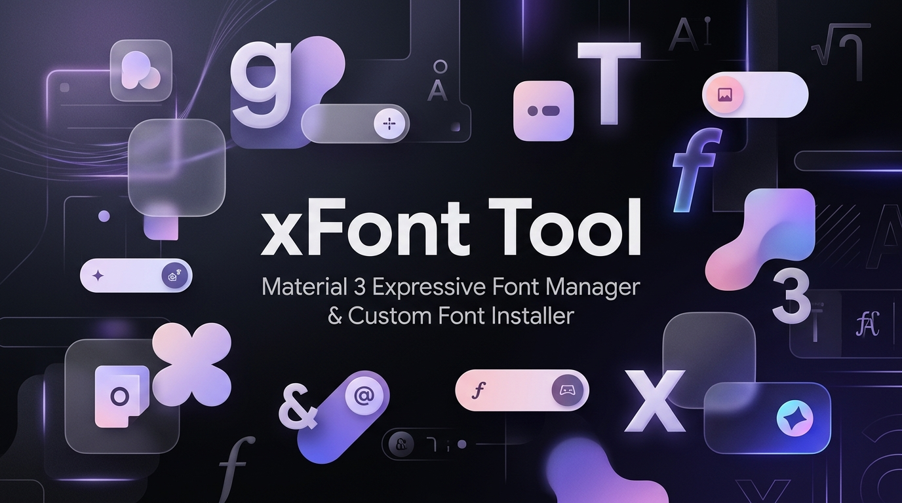
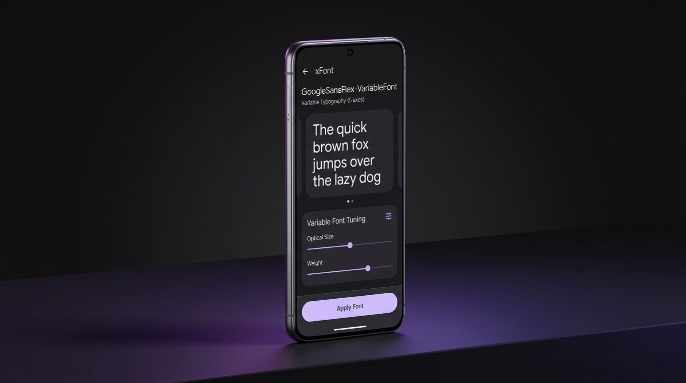
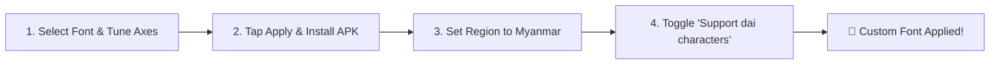

<div align="center">

# 𝘅𝗙𝗼𝗻𝘁 𝗧𝗼𝗼𝗹

### Modern Material 3 Expressive Font Manager & Custom Font Installer
**Designed specifically for Realme UI, ColorOS, and OxygenOS**

[](https://github.com/wdhairyaa/xfont-tool/releases)
[](https://github.com/wdhairyaa/xfont-tool)
[-FF5252?style=for-the-badge&logo=oppo)](https://github.com/wdhairyaa/xfont-tool)
[](https://github.com/wdhairyaa/xfont-tool)
[](LICENSE)

<br/>



</div>

---

## 📖 Overview & Motivation

**xFont Tool** is a modern, privacy-focused, 100% ad-free font manager and system font installer designed from the ground up for **Realme UI**, **ColorOS**, and **OxygenOS** devices.

Inspired by and built as a modern replacement for legacy tools like **zFont**, xFont Tool reimagines font customization for the modern Android era:
- 🚫 **Zero Ads & Zero Bloatware**: No full-screen popups, countdowns, tracking, or sketchy background services.
- 🎨 **Material 3 Expressive (M3E)**: Crafted with Google's latest Material 3 Expressive design language, fluid spring physics, organic shapes, and pure AMOLED black theming.
- ⚡ **True Variable Font Engine**: Powered by an on-device Python `fonttools` engine (`varLib.instancer`) to tune and freeze custom variable font axes (Weight, Optical Size, Width, Slant) without glyph distortion.
- 🔓 **No Root Required**: Seamlessly packages your custom typography into signed system-compatible APKs that utilize the built-in ColorOS/RealmeUI/OxygenOS font service.

> [!NOTE]
> **Real-World Tested on Realme UI 6.0 (Android 15)**  
> xFont Tool v1.11 has been verified and tested on **Realme UI 6.0 running Android 15**. Because ColorOS, Realme UI, and OxygenOS share the unified codebase, it is designed to work across recent and legacy versions. **Community testing and feedback on other ColorOS/OxygenOS versions and devices are warmly welcomed!**

---

<div align="center">

## 📱 App Showcase



</div>

---

## ✨ Features

### 🎨 Material 3 Expressive (M3E) & Pure AMOLED Design
- **16 Parametric Expressive Shapes**: File and folder item icons are enclosed within randomized organic M3 Expressive silhouettes—scalloped cookies, 4-leaf clovers, sunny bursts, gem cuts, squircles, and arches.
- **Pure AMOLED Pitch Black Theme**: True `#000000` dark mode tailored for OLED/AMOLED displays, maximizing battery savings and visual contrast.
- **Dynamic Theming & Static Palettes**: Fully supports Android 12+ wallpaper-extracted Material You color schemes, or customizable static palettes.
- **Modern Floating Navigation**: Centered capsule navbar with animated tab indicators, speed-dial FAB, and an elevated contextual action pill during multi-selection.
- **Fluid Gestures**: Horizontal swipe navigation between Home and Settings with Spring physics.
- **Optimized Density**: Refined 95% UI scaling by default for sharp typography on high-DPI displays.

### 🧪 Embedded Variable Font Engine (`fonttools`)
- Variable fonts (`.ttf` / `.otf` containing `fvar` tables) are detected and parsed in real time.
- Interactive tuning sliders for all available design axes: **Weight (`wght`)**, **Width (`wdth`)**, **Optical Size (`opsz`)**, **Slant (`slnt`)**, and custom vendor axes.
- Live on-screen typography preview updates smoothly as you adjust values.
- Built-in embedded Python `fonttools varLib.instancer` (via Chaquopy) freezes your chosen axis values into clean static TTF tables during APK generation, completely avoiding variable glyph rendering glitches.

### 📂 In-Place Font File Manager
- **Live In-List Font Rendering**: Each font file entry renders directly in its own real typography; folder titles stay in the system typeface for clean readability.
- **Distinct Iconography**: Bold sans-serif `T` emblems for font files, folder glyphs for directories, and document icons for imported non-font archives.
- **Multi-Select & Batch Actions**: Long-press to activate multi-select mode with floating pill controls for Cut, Copy, Rename, and Batch Delete.
- **Smart Scroll Position Restoration**: Remembers your exact scroll position per folder and immediately restores focus to the previously tapped font or folder when pressing Back.
- **Full Hierarchy & Search**: Interactive breadcrumbs navigation bar and instantaneous recursive search across all subdirectories.

### 📦 Direct Font APK Generation & Installation
- Compiles custom signed font APKs matching the exact signature and manifest requirements of the ColorOS/RealmeUI/OxygenOS font engine.
- Instant launch of the system Package Installer with a single tap.
- Automatically cleans up temporary cached instance files after installation.

---

## 🚀 How to Install & Apply Fonts

Follow this simple guide to apply custom fonts on Realme UI, ColorOS, or OxygenOS without root:



### Detailed Steps:
1. **Download & Install**: Grab the latest `xfont-tool-v1.13.apk` from the [Releases](https://github.com/wdhairyaa/xfont-tool/releases) section and install it.
2. **Add Your Fonts**: Tap the **+** FAB to import any `.ttf`, `.otf`, or variable font files or whole font folders.
3. **Customize / Preview**: Tap the font to enter preview mode. For variable fonts, tweak the sliders to your preferred weight or optical size.
4. **Build Font APK**: Tap **Apply Font**, then tap **Install Font APK** and confirm installation in the system package installer.
5. **Activate in System Settings**:
   - Open phone **Settings** ➡️ **Additional Settings** (or **System & Updates**) ➡️ **Language & Region**.
   - Set **Region** to **Myanmar**.
   - Go to **Display & Brightness**.
   - Toggle **Support dai characters** to **ON**.
6. Your system-wide typography is now instantly updated!

---

## 🛠️ Tech Stack & Architecture

- **UI & Architecture**: 100% Jetpack Compose with Material 3 Expressive, Single Activity, Coroutines & Kotlin Flows.
- **Typography Engine**: Embedded Python 3.14 via **Chaquopy** running upstream **`fonttools`** (`varLib.instancer`).
- **APK Builder**: Custom asset injector, binary XML generator, and Android APK signing pipeline.
- **Storage**: Non-scoped media storage (`Android/media/com.xfont.app/fonts`) allowing direct file management and access.

---

## 🏗️ Building from Source

To compile the project locally:

```bash
# Clone the repository
git clone https://github.com/wdhairyaa/xfont-tool.git
cd xfont-tool

# Build release APK
./gradlew assembleRelease
```

The output APK will be generated at:
`app/build/outputs/apk/release/app-release.apk`

---

## 🤝 Community & Feedback

Testing across diverse ColorOS and OxygenOS devices helps ensure rock-solid compatibility. If you test xFont Tool on your device:
- Open an [Issue](https://github.com/wdhairyaa/xfont-tool/issues) or [Discussion](https://github.com/wdhairyaa/xfont-tool/discussions) with your device model, Android version, and UI version.
- Pull requests and feature suggestions are always welcome!

---

## 📜 License

```
Copyright 2026 wdhairyaa

Licensed under the Apache License, Version 2.0 (the "License");
you may not use this file except in compliance with the License.
You may obtain a copy of the License at

    http://www.apache.org/licenses/LICENSE-2.0

Unless required by applicable law or agreed to in writing, software
distributed under the License is distributed on an "AS IS" BASIS,
WITHOUT WARRANTIES OR CONDITIONS OF ANY KIND, either express or implied.
See the License for the specific language governing permissions and
limitations under the License.
```
